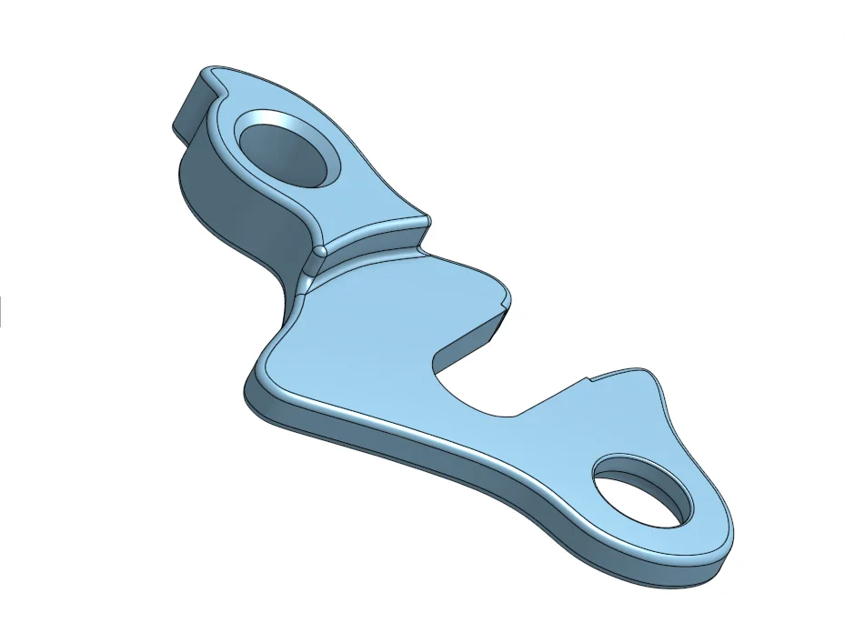
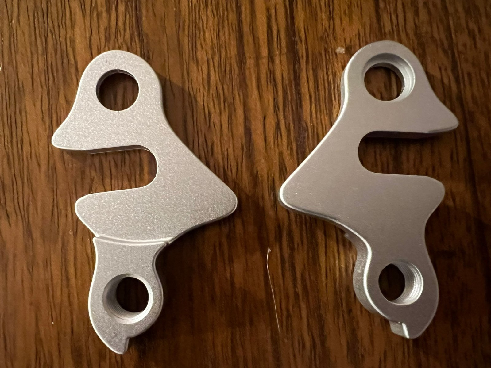
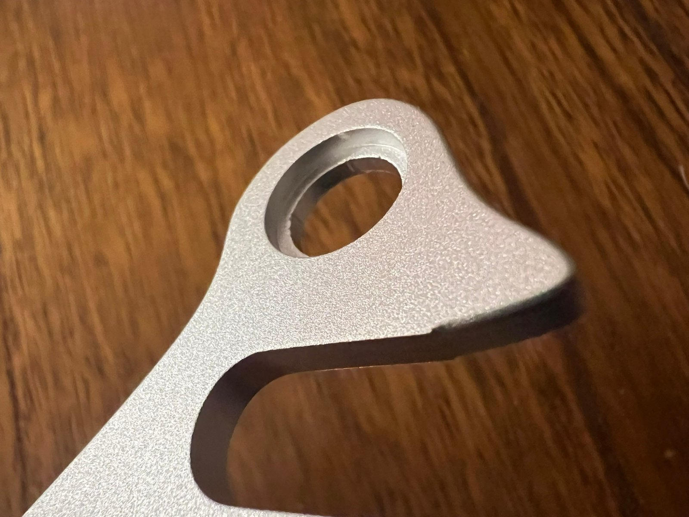
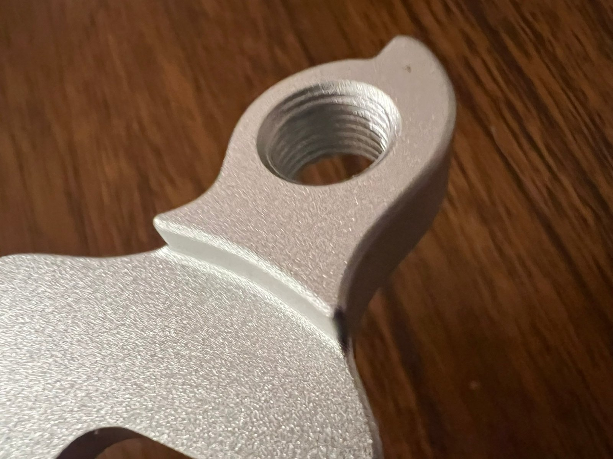

# RadWagon 3 (2019) derailleur hanger

Replacement derailleur hanger for the 2019 Rad Power Bikes RadWagon 3, machined from aluminium. Other model years may differ: compare with your own hanger before machining.

## Files

- [radwagon-3-hanger.step](radwagon-3-hanger.step): 3D model (profile, thickness, holes)
- [radwagon-3-hanger-thread-drawing.pdf](radwagon-3-hanger-thread-drawing.pdf): threading specification (A4, 1:1)

Give both files to a machine shop; they contain everything needed.

## Machining summary

- Profile: take it from the STEP file. The PDF drawing defines the threading only.
- Envelope: approx. 70.1 x 42.9 x 8.0 mm.
- Thread: **M10 x 1.0 - 6H**, one hole only, through 8 mm. Fine pitch 1.0 — *not* the standard M10 x 1.5.
- The Ø10.0 hole is a clearance hole (counterbore Ø12.47, 2.0 deep): **do not tap it**.
- Material: aluminium 6061-T6 (6082-T6 acceptable).
- General tolerance ISO 2768-m, deburr all edges.

## Pictures

3D model (Onshape):

Machined parts, both sides:

Clearance hole with counterbore, and the M10 x 1.0 threaded hole:

## Disclaimer

A derailleur hanger is a safety-relevant part of a bicycle. These files are provided **as is, without any warranty**. Check every dimension against your own bike and original part before machining, and use them at your own risk. See the [main README](../README.md) for the unofficial-project notice.

## Licence

[CC BY-SA 4.0](../LICENSE): credit the author (ben4096) and share modifications under the same licence.
